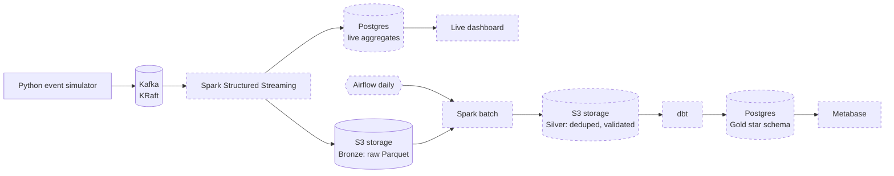

# Real-Time Electronics Retail Analytics Platform

An end-to-end streaming data platform for a simulated online electronics store.
A Python simulator produces clickstream, order, pricing and inventory events to
Kafka. Later phases process them with Spark Structured Streaming into a
bronze/silver/gold lakehouse on S3-compatible object storage, orchestrated by
Airflow and modelled with dbt.

Everything runs locally with Docker Compose. No cloud account is needed.

## Architecture



Dashed boxes are planned and not built yet. The S3 storage is SeaweedFS.

## Project status

| Phase | Scope | Status |
|-------|-------|--------|
| 1 | Kafka (KRaft) + event simulator | Done |
| 2 | S3-compatible storage, Spark streaming to bronze + live aggregates | In progress (storage done) |
| 3 | Batch silver layer, Airflow, dbt gold star schema | Planned |
| 4 | Data quality checks, CI (GitHub Actions), dashboards | Planned |

## Quick start

Prerequisites: Docker Desktop (about 8 GB available to Docker for the full
stack), Python 3.11.

```powershell
# 1. Configure
Copy-Item .env.example .env

# 2. Start Kafka, topics, Kafka UI and object storage
docker compose up -d
docker compose ps -a        # kafka healthy, kafka-init exited (0)

# 3. Install and run the simulator
py -3.11 -m venv .venv
.\.venv\Scripts\Activate.ps1
pip install -r simulator\requirements.txt
python simulator\simulator.py

# 4. Check the object store from Python (optional)
pip install -r scripts\requirements.txt
python scripts\s3_check.py
```

Stop the simulator with Ctrl+C.

| Service | URL / address | Purpose |
|---------|---------------|---------|
| Kafka (from host) | `localhost:9094` | Simulator and local tools |
| Kafka (from containers) | `kafka:9092` | Spark, Airflow |
| Kafka UI | http://localhost:8081 | Inspect topics and messages |
| S3 API (from host) | http://localhost:8333 | Object storage (bucket `lakehouse`) |
| S3 API (from containers) | http://seaweedfs:8333 | Spark, Airflow |
| SeaweedFS admin UI | http://localhost:23646 | Storage status and credentials |

## Kafka topics

| Topic | Key | Event types | Partitions |
|-------|-----|-------------|-----------|
| `orders` | user_id | order_placed | 3 |
| `page_views` | user_id | page_view | 3 |
| `cart_events` | user_id | cart_add, cart_remove | 3 |
| `price_changes` | product_id | price_change | 3 |
| `inventory_updates` | product_id | inventory_update | 3 |

Every event is JSON and carries `event_id` (UUID), `event_type` and `event_time`
(ISO 8601, UTC). Keys keep all events for one user (or product) in order within
a partition.

## Configuration

All settings are environment variables (see `.env.example`).

| Variable | Default | Meaning |
|----------|---------|---------|
| `KAFKA_BOOTSTRAP_SERVERS` | `localhost:9094` | Kafka address as seen from the host |
| `SIM_STEPS_PER_SECOND` | 20 | Simulation speed |
| `SIM_ACTIVE_SESSIONS` | 50 | Concurrent shopper sessions |
| `SIM_USER_POOL` | 2000 | Distinct users |
| `SIM_LATE_EVENT_RATE` | 0.02 | Share of events with `event_time` 1-10 min in the past |
| `SIM_DUPLICATE_RATE` | 0.01 | Share of events sent twice with the same `event_id` |
| `SIM_MAX_EVENTS` | 0 | Stop after N events (0 = run forever) |
| `SIM_SEED` | empty | Integer for reproducible runs |
| `S3_ACCESS_KEY` / `S3_SECRET_KEY` | demo values | Object store credentials |
| `S3_API_PORT` / `S3_ADMIN_UI_PORT` | 8333 / 23646 | Host ports for the object store |
| `LAKE_BUCKET` | `lakehouse` | Bucket created on startup |

## Design notes

- **Dual Kafka listeners:** containers use `kafka:9092`, the host uses
  `localhost:9094`, so the same broker serves both.
- **Realistic data problems on purpose:** late events and duplicate deliveries
  are injected so the silver layer has real deduplication and late-data
  handling to do.
- **Idempotent producer** (`acks=all`) avoids duplicates caused by producer retries.
  The deliberate duplicates above are separate and simulate upstream redelivery.
- **Topics are created explicitly** by `kafka-init`, with auto-creation disabled,
  so a typo in a topic name fails loudly.
- **SeaweedFS instead of MinIO:** MinIO withdrew its community Docker images in 2025-2026,
  so the S3 layer uses SeaweedFS (Apache-2.0). Spark and Airflow only use the S3 API
  (`s3a://`), so the store can be swapped for AWS S3 or GCS by changing the endpoint
  and credentials. The image version is pinned for reproducibility.

## Limitations

- Single-broker Kafka with replication factor 1, which is fine for local development
  and not fault tolerant.
- Single-node object store; no replication.
- Simulated data: patterns are plausible, not real customer behaviour.
- Local, unauthenticated services with demo configuration and hardcoded demo credentials only.