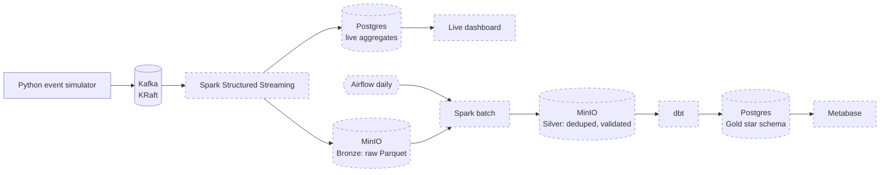

# Real-Time Electronics Retail Analytics Platform

An end-to-end streaming data platform for a simulated online electronics store.
A Python simulator produces clickstream, order, pricing and inventory events to
Kafka. Later phases process them with Spark Structured Streaming into a
bronze/silver/gold lakehouse on MinIO, orchestrated by Airflow and modelled with dbt.

Everything runs locally with Docker Compose. No cloud account is needed.

## Architecture



Dashed boxes are planned and not built yet.

## Project status

| Phase | Scope | Status |
|-------|-------|--------|
| 1 | Kafka (KRaft) + event simulator | Done |
| 2 | Spark streaming to MinIO bronze + live aggregates | Planned |
| 3 | Batch silver layer, Airflow, dbt gold star schema | Planned |
| 4 | Data quality checks, CI (GitHub Actions), dashboards | Planned |

## Quick start (Phase 1)

Prerequisites: Docker Desktop, Python 3.11.

```powershell
# 1. Configure
Copy-Item .env.example .env

# 2. Start Kafka, create topics, start Kafka UI
docker compose up -d
docker compose ps -a        # kafka healthy, kafka-init exited (0)

# 3. Install and run the simulator
py -3.11 -m venv .venv
.\.venv\Scripts\Activate.ps1
pip install -r simulator\requirements.txt
python simulator\simulator.py
```

Kafka UI: http://localhost:8081. Stop the simulator with Ctrl+C.

## Kafka topics

| Topic | Key | Event types | Partitions |
|-------|-----|-------------|-----------|
| `orders` | user_id | order_placed | 3 |
| `page_views` | user_id | page_view | 3 |
| `cart_events` | user_id | cart_add, cart_remove | 3 |
| `price_changes` | product_id | price_change | 3 |
| `inventory_updates` | product_id | inventory_update | 3 |

Every event is JSON and carries `event_id` (UUID), `event_type` and `event_time`
(ISO 8601, UTC). Keys keep all events for one user (or product) in order within
a partition.

## Simulator configuration

All settings are environment variables (see `.env.example`).

| Variable | Default | Meaning |
|----------|---------|---------|
| `KAFKA_BOOTSTRAP_SERVERS` | `localhost:9094` | Kafka address as seen from the host |
| `SIM_STEPS_PER_SECOND` | 20 | Simulation speed |
| `SIM_ACTIVE_SESSIONS` | 50 | Concurrent shopper sessions |
| `SIM_USER_POOL` | 2000 | Distinct users |
| `SIM_LATE_EVENT_RATE` | 0.02 | Share of events with `event_time` 1-10 min in the past |
| `SIM_DUPLICATE_RATE` | 0.01 | Share of events sent twice with the same `event_id` |
| `SIM_MAX_EVENTS` | 0 | Stop after N events (0 = run forever) |
| `SIM_SEED` | empty | Integer for reproducible runs |

## Design notes

- **Dual Kafka listeners:** containers use `kafka:9092`, the host uses
  `localhost:9094`, so the same broker serves both.
- **Realistic data problems on purpose:** late events and duplicate deliveries
  are injected so the silver layer has real deduplication and late-data
  handling to do.
- **Idempotent producer** (`acks=all`) avoids duplicates caused by producer retries.
  The deliberate duplicates above are separate and simulate upstream redelivery.
- **Topics are created explicitly** by `kafka-init`, with auto-creation disabled,
  so a typo in a topic name fails loudly.

## Limitations

- Single-broker Kafka with replication factor 1, which is fine for local development
  and not fault tolerant.
- Simulated data: patterns are plausible, not real customer behaviour.
- Local, unauthenticated services with demo configuration only.